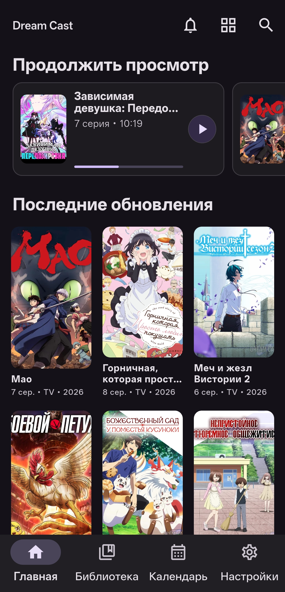
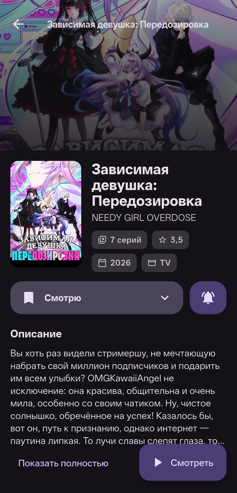
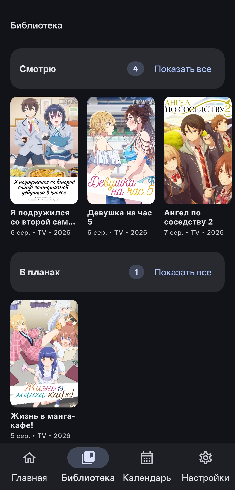

<p align="center"></p>

# Dream Cast TV

Неофициальный клиент Dream Cast для **Android TV и Google TV** на Flutter.
Модификация открытого проекта [rurin1x/dreamcast-app](https://github.com/rurin1x/dreamcast-app).

Ветка `develop` содержит текущие доработки и тестовые сборки. Версия в
`pubspec.yaml` — **0.7.1+710001**; номер APK не является номером этапа разработки.
Проверка воспроизведения и системного ввода на устройствах продолжается.

## Возможности

- Каталог, поиск, карточки тайтлов и списки серий.
- Библиотека и закладки, календарь, подписки на новые серии и уведомления.
- Сохранение позиции и «Продолжить просмотр».
- Управление пультом: пауза, перемотка, качество и ручной переход к следующей серии.
- Автопереход после завершения серии с возможностью отмены.
- Светлая и тёмная темы, настраиваемый акцент, единый контурный стиль кнопок.
- Два независимых видеодвижка; автоматического переключения между ними нет.

Скачивание серий удалено. Доступность каталога и видео зависит от сервиса и сети.

## Какой APK выбрать

| Вариант | Движок | Устройство |
| --- | --- | --- |
| `software_AV1` / flavor `softwareAv1` | LibVLC, программное декодирование AV1 | Android TV без аппаратного AV1, в том числе Cosmos |
| `hardware_AV1` / flavor `hardwareAv1` | AndroidX Media3 / ExoPlayer | Android TV / Google TV с аппаратным AV1 |

Для Cosmos используется **720p**; Auto в software также выбирает 720p.
Hardware использует адаптивный поток в Auto. Доступны также 480p, 720p и 1080p;
реальная доступность качества зависит от источника.

Варианты одного режима используют общий package ID, поэтому одновременно
установить software и hardware нельзя:

| Режим | Package ID |
| --- | --- |
| Debug | `com.dreamcast.app.diagnostic` |
| Release | `com.dreamcast.app` |

## Получение и установка

Для текущего `develop` откройте [GitHub Actions](https://github.com/Arleckin75/dreamcast-tv/actions/workflows/build-tv-apk.yml),
выберите успешный запуск **Build Dream Cast TV APK** и скачайте нужный ZIP из Artifacts:

- `dreamcast-tv-v0.7.1-software_AV1-debug`;
- `dreamcast-tv-v0.7.1-hardware_AV1-debug`.

В ZIP находятся APK и контрольная сумма SHA-256. Для скачивания артефактов может
потребоваться вход в GitHub. Подписанные опубликованные версии доступны на
[Releases](https://github.com/Arleckin75/dreamcast-tv/releases), если выпуск опубликован.

Установите APK через файловый менеджер TV или ADB. Обновление с сохранением данных
требует совместимой подписи. Debug-сертификаты разных запусков и двух вариантов
могут отличаться; одинаковое имя APK не гарантирует возможность обновления.
Удаление приложения стирает его локальные данные.

## Управление

В обоих плеерах сверху расположены возврат, название серии, качество и
«Следующая серия»; в центре — пауза, снизу — шкала времени. На последней серии
кнопка ручного перехода скрыта. Боковые кнопки перемотки убраны.

| Кнопка пульта | Действие |
| --- | --- |
| Стрелки | Навигация; влево/вправо на паузе или при скрытой панели — перемотка на 10 секунд |
| Вверх/вниз при скрытой панели | Показать управление |
| OK / Select | Выполнить выбранное действие, воспроизведение/пауза |
| Back | Назад; в software сначала скрывает открытую панель, затем выходит из видео |
| Удержание Back около 1,5 с | Выход из основного окна приложения, если устройство передаёт удержание |

## Статус проверки

- Общая компоновка и стиль плееров унифицированы; движки остаются независимыми.
- На Cosmos с Android TV 11 обнаружен сбой управления Gboard в обычном Flutter-поле.
  Для software подготовлено **одно встроенное поле Android в строке поиска**,
  без отдельного окна и второго поля. Эта реализация ещё требует проверки на TV.
  Hardware сохраняет обычное поле Flutter.
- Короткое наблюдение software-720p не показало устойчивого роста памяти;
  оно не заменяет длительный тест. Замеры скорости запуска до/после ещё не завершены.
- Widget-тесты и компиляция не подтверждают работу физического пульта, IME или декодера.

## Сборка и проверка

Используются **Flutter 3.41.5**, Dart из этого SDK, **JDK 17** и Android SDK.
Версия NDK закреплена в `.android-ndk-version`.

```sh
flutter pub get --enforce-lockfile
flutter analyze --no-pub
flutter test --no-pub
flutter test --no-pub test/software_player_test.dart test/features/releases/search_keyboard_test.dart test/features/player/tv_player_test.dart --flavor softwareAv1
```

Для APK используйте helper, который выбирает flavor и соответствующий видеоплагин:

```sh
dart run scripts/build_tv.dart hardware debug --check
dart run scripts/build_tv.dart software debug --check
```

Перед локальной software-сборкой нужен сокращённый LibVLC из артефакта
`libvlc-tv-maven`, распакованный в `.tools/libvlc-tv/maven`. Полная библиотека
не используется как запасной вариант. Подробности: [сборка](BUILD_TV.md),
[подпись Release](RELEASE_SIGNING_RU.md), [профиль LibVLC](third_party/libvlc_tv/README.md).

| Workflow | Назначение |
| --- | --- |
| `verify.yml` | Анализ, Flutter-тесты и проверки инструментов при изменениях develop |
| `build-tv-apk.yml` | Сборка двух APK, аудит движков, ABI и подписи; публикация Release только из main по явному запросу |
| `build-libvlc-tv.yml` | Сборка сокращённого LibVLC для двух ARM ABI |
| `build-tv-release.yml` | Ручной запуск Release-сборки через основной workflow без публикации |

## Документация

- [Управление software-плеером](docs/SOFTWARE_PLAYER_CONTROLS_RU.md)
- [Системный ввод поиска на Cosmos](docs/TV_SEARCH_INPUT_RU.md)
- [Стиль кнопок](docs/UI_BUTTON_STYLE_RU.md)
- [Замеры производительности](docs/TV_PERFORMANCE_RU.md)
- [Наблюдение стабильности TV](docs/TV_STABILITY_2026-11-02.md)
- [Размер и состав LibVLC](docs/LIBVLC_SIZE_AUDIT_RU.md)

## Скриншоты

Снимки предыдущего состояния интерфейса; актуальное оформление может отличаться.

| Каталог | Тайтл | Библиотека |
| --- | --- | --- |
|  |  |  |

## Лицензия

Оригинальный проект создан **rurin1x**. Изменения для TV развиваются в
[Arleckin75/dreamcast-tv](https://github.com/Arleckin75/dreamcast-tv).
Лицензия — [GNU GPL v3](LICENSE). Используемые сторонние компоненты сохраняют
собственные лицензии. Проект не связан с администрацией сервиса Dream Cast.
