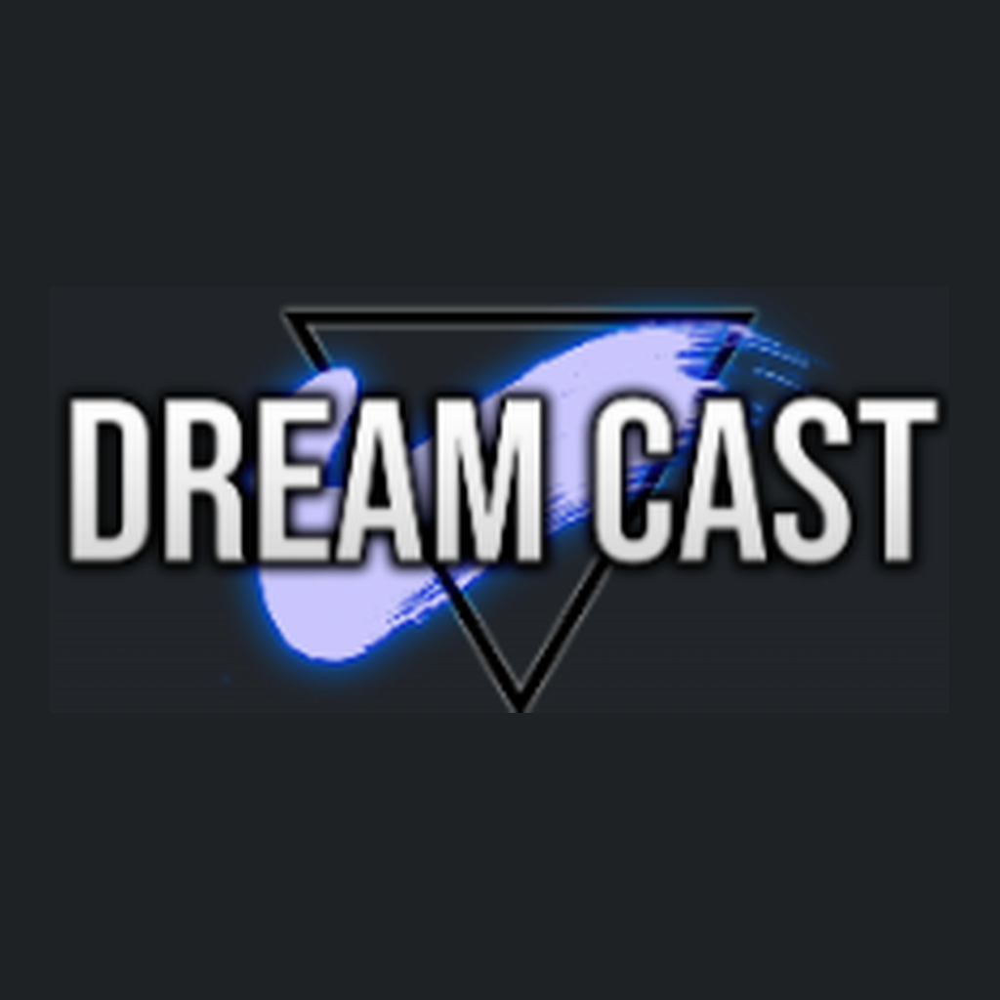

<p align="center">
  
</p>

<h1 align="center">Dream Cast TV</h1>

<p align="center">Неофициальная модификация открытого Android-клиента Dream Cast для Android TV и Google TV.</p>

> **Статус:** Android TV-адаптация v0.6 протестирована на телевизоре. Проект не является официальным приложением Dream Cast и не связан с администрацией сервиса.

## Возможности

- Каталог аниме с постерами и описаниями, открытие карточек и выбор эпизодов.
- Поиск с обновлением результатов во время ввода.
- Библиотека, календарь релизов и уведомления.
- Воспроизведение видео и звука, пауза и перемотка.
- Локальный профиль `TV`, закладки и сохранение прогресса просмотра.
- Интерфейс для телевизора с верхней панелью навигации; первый запуск без мастера настройки.

Доступность видео зависит от сайта Dream Cast, сети и прав на соответствующий контент.

## Управление пультом

| Кнопка | Действие |
| --- | --- |
| Стрелки D-pad | Перемещение между элементами; в плеере влево/вправо — перемотка |
| OK / Select | Открыть выбранный элемент; в плеере — воспроизведение/пауза |
| Back (коротко) | Назад на предыдущий экран; при открытой клавиатуре — сначала закрыть её |
| Back (удержание около 1,5 с) | Выход из приложения, если устройство передаёт удержание приложению |

В поиске после закрытия клавиатуры стрелка вниз переводит фокус к результатам. При возврате из карточки сохраняется введённый запрос.

## Установка

Готовые опубликованные версии следует искать на странице [Releases этого репозитория](https://github.com/Arleckin75/dreamcast-tv/releases). **На момент подготовки этого README отдельный GitHub Release не подтверждён.**

Если на странице Releases нет APK, артефакты тестовых сборок могут быть доступны владельцу репозитория в [GitHub Actions](https://github.com/Arleckin75/dreamcast-tv/actions) после успешного запуска workflow. Для загрузки артефактов могут потребоваться вход в GitHub и соответствующие права доступа.

APK устанавливается вручную на совместимое устройство Android TV / Google TV. Release APK, подписанный другим сертификатом, нельзя установить поверх Debug APK с тем же идентификатором приложения; удаление старой версии может удалить локальные данные.

## Сборка из исходников

Требуются Flutter SDK, Android SDK и совместимая версия JDK.

```bash
flutter pub get
flutter analyze
flutter test
flutter build apk --debug
```

Для Release требуется собственный Android signing key и корректная конфигурация подписи. **Не коммитьте** `.jks`, `.keystore`, `android/key.properties` или пароли.

```bash
flutter build apk --release
```

### GitHub Actions

- `build-tv-apk.yml` — тестовый Debug APK.
- `build-tv-release.yml` — вручную запускаемая Release-сборка с подписью через Environment `release-signing`.

Для подписи используются Environment Secrets (только имена, не значения):

| Secret | Назначение |
| --- | --- |
| `TV_RELEASE_KEYSTORE_BASE64` | Base64-представление ключевого хранилища |
| `TV_RELEASE_STORE_PASSWORD` | Пароль хранилища |
| `TV_RELEASE_KEY_PASSWORD` | Пароль ключа |
| `TV_RELEASE_KEY_ALIAS` | Alias ключа |

Публикация исходников не требует публикации ключа. Доступ к подписывающим workflow должен оставаться ограниченным доверенными участниками.

## Происхождение, авторство и лицензия

Dream Cast TV — модификация проекта [rurin1x/dreamcast-app](https://github.com/rurin1x/dreamcast-app). Оригинальная реализация создана **rurin1x**; изменения для Android TV развиваются в [Arleckin75/dreamcast-tv](https://github.com/Arleckin75/dreamcast-tv).

Приложение распространяется на условиях **GNU General Public License v3.0**. Полный текст находится в файле [LICENSE](LICENSE). При распространении модифицированных версий необходимо соблюдать условия применимых лицензий и сохранять необходимые сведения об авторских правах.

В оригинальном проекте отмечено использование идей парсинга из [vypivshiy/anicli-api](https://github.com/vypivshiy/anicli-api) (MIT License); реализация клиента выполнена на Dart. Сторонние зависимости и ресурсы могут иметь собственные условия использования.

**Отказ от аффилиации:** приложение является независимым клиентом. Название, логотип и медиаматериалы Dream Cast принадлежат соответствующим правообладателям. Исходный код приложения и доступность видеоконтента не предоставляют автоматически права на распространение чужих изображений, логотипов или видео.

## Основные технологии

Flutter / Dart, Riverpod, GoRouter, Dio, Drift и `video_player`. Данные каталога извлекаются через сетевой слой и парсер приложения, без встроенного WebView.

## Разработка

- `main` — стабильный исходный код.
- `develop` — текущая разработка Android TV.
- `stable-v0.5` — сохранённая резервная ветка v0.5.

Перед выпуском APK рекомендуется выполнять сборку, проверку навигации пультом и тестирование на реальном Android TV.
